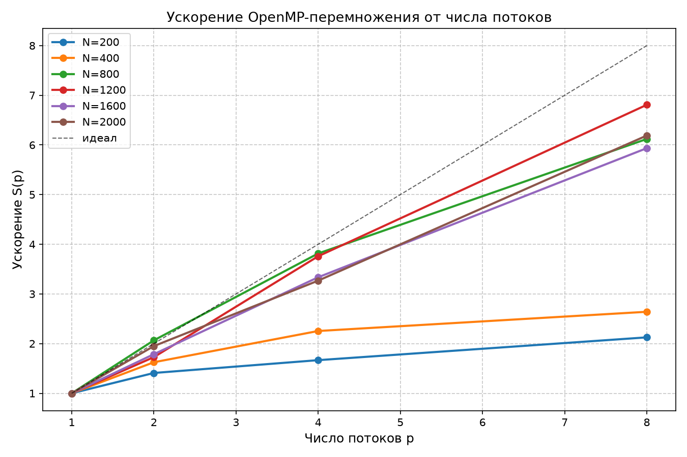
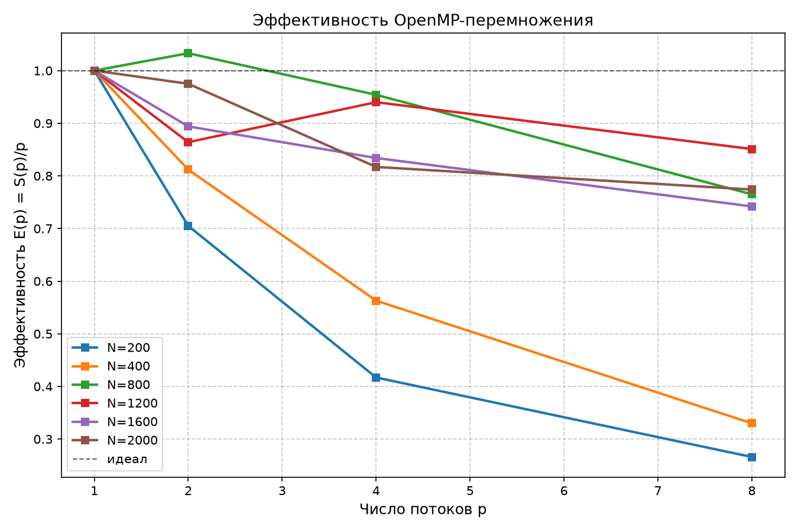
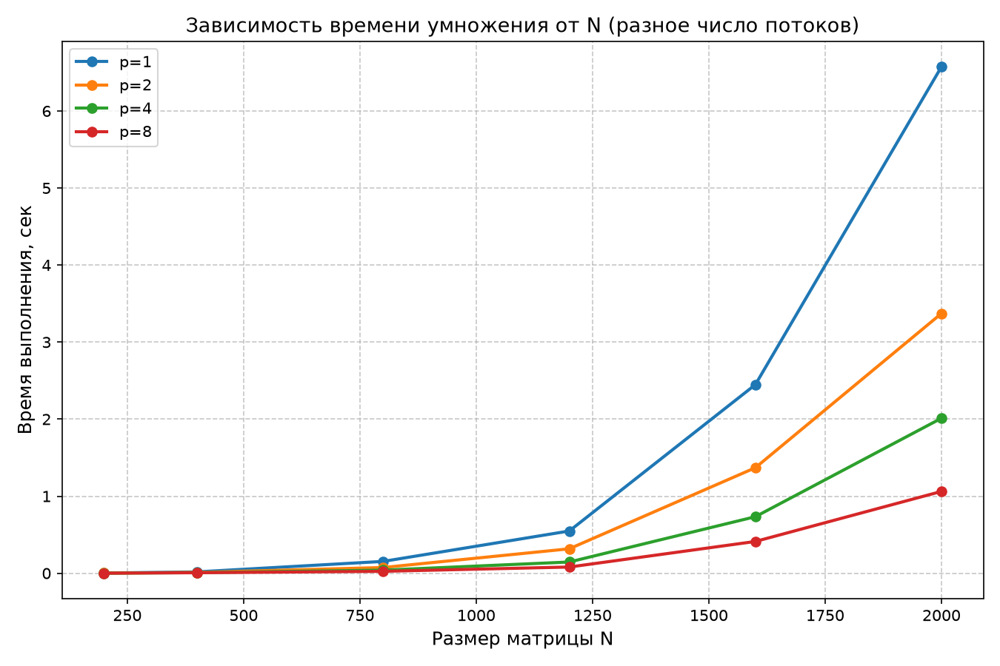

# Лабораторная работа №2
## Умножение квадратных матриц (OpenMP)

**Выполнил студент:** Екимов Никита Алексеевич
**Группа:** 6214-100503D  
**Курс:** Параллельное программирование

---

## 1. Задание

Модифицировать программу из ЛР №1 для параллельной работы по технологии OpenMP. 
Провести серию экспериментов с разным количеством потоков (1, 2, 4, 8) и разными размерами матриц (200, 400, 800, 1200, 1600, 2000).

---

## 2. Реализация

- Язык: C++17, компилятор MSVC (Visual Studio).
- Распараллеливание: `#pragma omp parallel for` — каждый поток считает свои строки результата.
- Число потоков задаётся через переменную окружения `OMP_NUM_THREADS`.
- Внутренний цикл идёт в порядке `i-k-j` (так быстрее работает с памятью).
- При записи результата используется высокая точность (`precision(17)`), чтобы не терять цифры.
- Верификация: Python + NumPy.

### Параллельный участок кода

```cpp
#pragma omp parallel for schedule(static)
for (int i = 0; i < n; ++i) {
    for (int k = 0; k < n; ++k) {
        double a = A[i][k];
        const double* Bk = B[k].data();
        double* Ci = C[i].data();
        for (int j = 0; j < n; ++j)
            Ci[j] += a * Bk[j];
    }
}
```

Каждый поток берёт себе часть строк матрицы `C`, поэтому потоки не мешают друг другу и не нужно дополнительно синхронизировать вычисления. Сложность алгоритма — **O(N³)**, как и в ЛР №1.

---

## 3. Структура проекта

```
parallel_programming/
├── lab1/                         <-- (ЛР1)
├── lab2/
│   ├── src/lab2_omp.cpp
│   ├── input/
│   ├── output/
│   ├── speedup.png
│   ├── efficiency.png
│   ├── time_vs_size.png
│   └── README.md
├── scripts/
│   ├── generate_matrix.py
│   ├── verify.py
│   ├── experiments.py
│   ├── plot_graphs.py
│   ├── experiments_omp.py        <-- новый (ЛР2)
│   └── plot_graphs_omp.py        <-- новый (ЛР2)
└── README.md
```

---

## 4. Верификация

Результат программы сравнивается с тем, что считает NumPy.

**Команда:**
```
py -3.12 scripts\verify.py lab2\input\matrix_a.txt lab2\input\matrix_b.txt lab2\output\result.txt 1e-8
```

**Результат (N = 200):**
```
[OK] ВЕРИФИКАЦИЯ ПРОЙДЕНА (макс. расхождение: 2.05e-12)
```

Расхождение очень маленькое (2.05·10⁻¹²), это нормальная точность для `double`. Порог `1e-8` выбран с запасом для больших матриц (до N = 2000).

---

## 5. Результаты экспериментов

Замеры для N = 200…2000 и потоков p = 1, 2, 4, 8. Полная таблица: [`output/experiments_omp.txt`](output/experiments_omp.txt).

| N    | p=1, с  | p=2, с  | p=4, с  | p=8, с  | Ускорение S(8) | Эффективность E(8) |
|-----:|--------:|--------:|--------:|--------:|:--------------:|:------------------:|
| 200  | 0.0024 | 0.0017 | 0.0014 | 0.0011 | 2.18 | 0.27 |
| 400  | 0.0177 | 0.0109 | 0.0079 | 0.0067 | 2.64 | 0.33 |
| 800  | 0.1536 | 0.0743 | 0.0403 | 0.0251 | 6.12 | 0.77 |
| 1200 | 0.5483 | 0.3173 | 0.1459 | 0.0805 | 6.81 | 0.85 |
| 1600 | 2.4479 | 1.3695 | 0.7337 | 0.4125 | 5.94 | 0.74 |
| 2000 | 6.5740 | 3.3721 | 2.0119 | 1.0622 | 6.19 | 0.77 |

- **Ускорение** = во сколько раз быстрее стало на 8 потоках.
- **Эффективность** = какая доля от идеала реально используется (1.0 = 100%).

---

## 6. Графики

### Ускорение от числа потоков



Для больших матриц (N = 800…2000) ускорение на 8 потоках достигает **6–6.8×** — почти как число ядер. Для маленькой матрицы (N = 200) ускорения почти нет: задача слишком маленькая, и время уходит на «раздачу» работы потокам.

### Эффективность



Для маленьких N эффективность падает сильно (N = 200 на 8 потоках — 0.27, то есть большая часть времени впустую). Для больших N (800–2000) держится на уровне 0.7–0.85.

Небольшой «горб» выше 1.0 на N = 800 при p = 2 — это эффект кэша, не ошибка.

### Время от размера задачи



Время растёт как N³ (матрица больше в 2 раза — работы в 8 раз больше). Видно, что с ростом числа потоков линия становится более пологой.

---

## 7. Выводы

1. **OpenMP хорошо работает на больших матрицах.** Ускорение на 8 потоках достигает 6–6.8× для N = 800…2000. Лучший результат — N = 1200: ускорение 6.81×.

2. **Маленькие матрицы параллелятся хуже.** На N = 200 весь расчёт занимает около 2 мс, и время на создание потоков сравнимо с самим расчётом. Ускорение 2.18× на 8 потоках — это предел для такой маленькой задачи.

3. **Очень большие матрицы упираются в память.** На N = 2000 GFLOPS падает до 15 (при 44 на N = 800), хотя время всё ещё улучшается от потоков. Матрица B (~32 МБ) не влезает в кэш, и процессор часто ждёт данные из оперативной памяти.

4. **Сложность остаётся O(N³).** По графику времени видно, что при увеличении матрицы в 2 раза работы становится примерно в 8 раз больше. Параллелизм уменьшает время, но не меняет саму сложность алгоритма.

5. **Проверка через NumPy работает надёжно.** Порог `1e-8` подходит для всех размеров до N = 2000. На N = 200 расхождение порядка 2·10⁻¹² — это машинная точность `double`.

---

## 8. Запуск

### Сборка

```
cl /O2 /openmp /EHsc /std:c++17 /MD lab2\src\lab2_omp.cpp /Fe:lab2\lab2_omp.exe
```

### Генерация матриц

```
py -3.12 scripts\generate_matrix.py 200 lab2\input\matrix_a.txt lab2\input\matrix_b.txt
```

### Запуск умножения

```
set OMP_NUM_THREADS=4
lab2\lab2_omp.exe lab2\input\matrix_a.txt lab2\input\matrix_b.txt lab2\output\result.txt lab2\output\info.txt
```

Программа пишет результат в `lab2\output\result.txt`, а статистику (n, threads, time_sec, GFLOPS, volume, ops) — в `lab2\output\info.txt`, и дублирует то же самое в консоль.

### Верификация

```
py -3.12 scripts\verify.py lab2\input\matrix_a.txt lab2\input\matrix_b.txt lab2\output\result.txt 1e-8
```

### Полная серия экспериментов и графики

```
py -3.12 scripts\experiments_omp.py
py -3.12 scripts\plot_graphs_omp.py
```