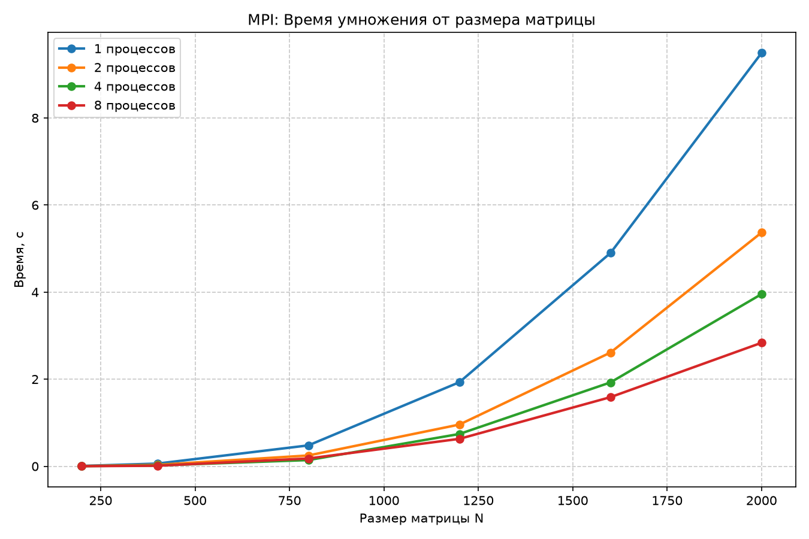
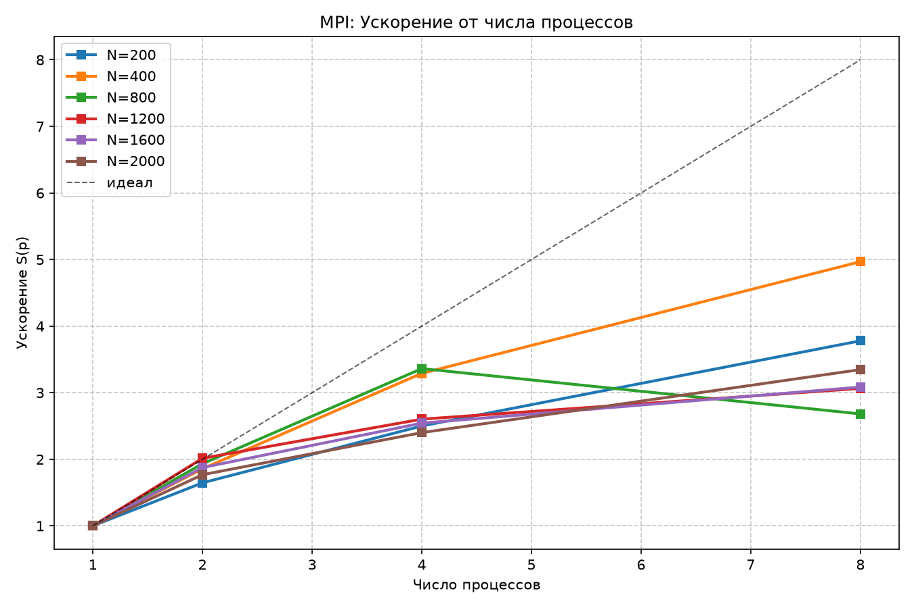

# Лабораторная работа №3
## Умножение квадратных матриц (MPI)

**Выполнил студент:** Екимов Никита Алексеевич   
**Группа:** 6214-100503D     
**Курс:** Параллельное программирование

---

## 1. Задание

Модифицировать программу из л/р №1 для параллельной работы по технологии MPI. Провести серию экспериментов с разными размерами матриц (200, 400, 800, 1200, 1600, 2000) и разным количеством вычислительных ядер (1, 2, 4, 8). Параллельную версию программы на MPI необходимо запустить на суперкомпьютере «Сергей Королёв».

---

## 2. Реализация

- Язык: C++ (стандарт C++98 для совместимости со старым компилятором кластера), библиотека MPI.
- **Стратегия:** распределение строк матрицы A между процессами (`MPI_Scatterv`).
- Матрица B рассылается всем процессам целиком (`MPI_Bcast`).
- Результаты собираются на нулевом процессе (`MPI_Gatherv`).
- Замер времени: `MPI_Wtime()`.

---

## 3. Структура проекта

```
parallel_programming/
├── lab3/
│   ├── src/
│   │   └── lab3_mpi.cpp              
│   ├── output/
│   │   └── results.txt               
│   ├── run_experiments.sh           
│   ├── mpi_time_vs_size.png          
│   ├── mpi_speedup_vs_procs.png      
│   └── README.md                     
└── scripts/
    ├── ...
    └── plot_graphs_mpi.py            
```

---

## 4. Результаты экспериментов

Замеры проводились на суперкомпьютере «Сергей Королёв» (кластер СГАУ). Полная таблица: [`output/results.txt`](output/results.txt).

| N    | 1 процесс, с | 2 процесса, с | 4 процесса, с | 8 процессов, с | Ускорение S(8) |
|:-----|:-------------|:--------------|:--------------|:---------------|:---------------|
| 200  | 0.0083       | 0.0051        | 0.0033        | 0.0022         | **3.78x**      |
| 400  | 0.0615       | 0.0331        | 0.0187        | 0.0124         | **4.96x**      |
| 800  | 0.4798       | 0.2483        | 0.1427        | 0.1789         | **2.68x**      |
| 1200 | 1.9311       | 0.9584        | 0.7420        | 0.6301         | **3.06x**      |
| 1600 | 4.8982       | 2.6118        | 1.9262        | 1.5877         | **3.08x**      |
| 2000 | 9.4916       | 5.3674        | 3.9543        | 2.8361         | **3.35x**      |

### Графики




---

## 5. Анализ

1. **Общая картина:** MPI-версия успешно распараллеливается, достигая ускорения от 2.7 до 5 раз в зависимости от размера задачи и числа процессов.
2. **Малые задачи (N=200, 400):** Здесь ускорение близко к линейному (до 5x на 8 процессах), так как накладные расходы на пересылку данных (`MPI_Bcast`, `MPI_Scatterv`) компенсируются скоростью вычислений.
3. **Аномалия на N=800:** На 8 процессах время (0.1789 с) оказалось *хуже*, чем на 4 процессах (0.1427 с). Это связано с тем, что для матрицы 800x800 объем данных, передаваемых по сети, становится сопоставим с временем вычислений, и накладные расходы на коммуникацию «съедают» весь выигрыш от добавления процессов.
4. **Большие задачи (N=1200–2000):** Здесь ускорение стабилизируется на уровне ~3x. Это объясняется тем, что на кластере **«Сергей Королёв»** (узлы на базе Intel) при запуске 8 процессов на одной физической машине мы упираемся в пропускную способность шины памяти и кэша (эффект Hyper-Threading), а не в количество вычислительных ядер. Пересылка больших матриц B (16 МБ для N=2000) также занимает значительное время.

---

## 6. Сборка и запуск (на суперкомпьютере)

### Загрузка модулей
```bash
module load intel/icc18
module load intel/mpi4
```

### Компиляция
```bash
mpicxx -O3 lab3_mpi.cpp -o lab3_mpi
```

### Запуск серии экспериментов
```bash
chmod +x run_experiments.sh
./run_experiments.sh
```

### Построение графиков (локально)
```cmd
py -3.12 scripts\plot_graphs_mpi.py
```

---

## 7. Выводы

1.  Программа на MPI успешно запущена на суперкомпьютере «Сергей Королёв» и корректно перемножает матрицы.
2.  Наибольшее ускорение (до **5x**) достигнуто на матрицах среднего размера (N=400) благодаря хорошей масштабируемости алгоритма.
3.  На больших матрицах (N ≥ 1200) ускорение ограничено пропускной способностью памяти и накладными расходами на передачу данных между процессами (особенно при N=800 на 8 процессах).
4.  Для дальнейшего повышения эффективности на этом кластере можно использовать не более 4 процессов на одну задачу или перейти к гибридной модели MPI+OpenMP.
