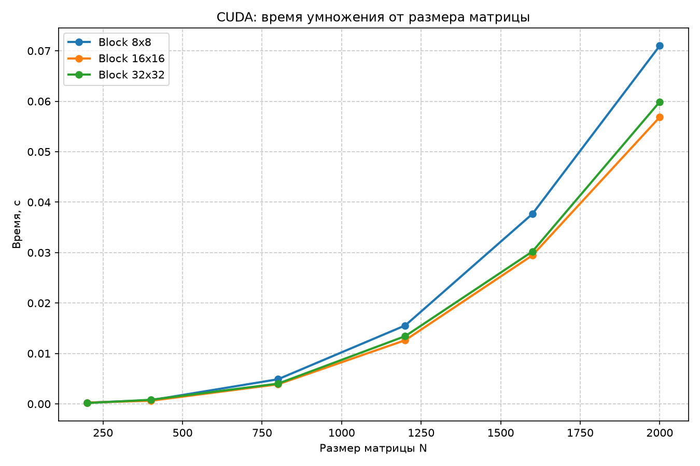
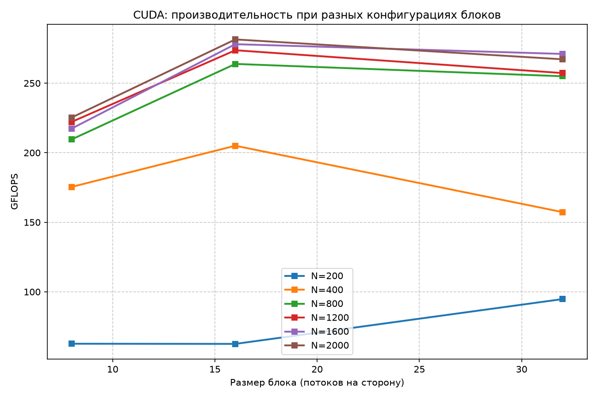

# Лабораторная работа №4
## Умножение квадратных матриц (CUDA)

**Выполнил студент:** Екимов Никита Алексеевич
**Группа:** 6214-100503D  
**Курс:** Параллельное программирование

---

## 1. Задание

Модифицировать программу из л/р №1 для параллельной работы по технологии CUDA. Провести эксперименты с разными размерами матриц и различными конфигурациями сетки блоков.

---

## 2. Реализация

- Язык: CUDA C++ (компилятор `nvcc` 13.4, MSVC x64).
- **Стратегия:** Tiled-умножение с использованием разделяемой памяти (`__shared__`).
- **Как работает:** каждый блок потоков размером `TILE x TILE` загружает кусок матрицы A и B в быструю разделяемую память, синхронизируется и считает частичную сумму.
- Размер блока (`blockSize`) — параметр командной строки: 8, 16, 32.
- Тип данных: `float` (одинарная точность, как принято на GPU).
- Верификация: NumPy, допуск `0.1` (из-за потери точности `float` при больших N).

### Параллельный участок кода (ядро)

```cpp
__global__ void matrixMulTiled(const float* A, const float* B, float* C, int N) {
    __shared__ float As[TILE][TILE];
    __shared__ float Bs[TILE][TILE];
    // ... загрузка плитки в shared memory, синхронизация и вычисление ...
}
```

---

## 3. Структура проекта

```
parallel_programming/
├── lab4/
│   ├── src/
│   │   └── lab4_cuda.cu             
│   ├── input/
│   │   ├── matrix_a.txt
│   │   └── matrix_b.txt
│   ├── output/
│   │   ├── result.txt                
│   │   ├── info.txt                  
│   │   └── experiments_cuda.txt      
│   ├── cuda_time_vs_size.png        
│   ├── cuda_gflops_vs_block.png     
│   └── README.md                     
└── scripts/
    ├── experiments_cuda.py           
    └── plot_graphs_cuda.py 
    └── ...         
```

---

## 4. Результаты экспериментов

Замеры для N = 200…2000 и блоков 8x8, 16x16, 32x32. Полная таблица: [`output/experiments_cuda.txt`](output/experiments_cuda.txt).

| N    | 8x8, GFLOPS | 16x16, GFLOPS | 32x32, GFLOPS |
|:-----|:------------|:--------------|:--------------|
| 200  | 62.66       | 62.55         | 94.75         |
| 400  | 175.45      | 205.03        | 157.32        |
| 800  | 209.61      | 263.86        | 254.99        |
| 1200 | 222.21      | 273.70        | 257.29        |
| 1600 | 217.41      | 278.05        | 271.05        |
| 2000 | 225.36      | **281.48**    | 267.19        |

**Лучший результат:** N=2000, блок **16x16** — **281.48 GFLOPS**.

---

## 5. Графики

### Время от размера матрицы



Время растёт как O(N³), как и ожидалось. Блок 16x16 показывает лучший результат для больших N.

### Производительность (GFLOPS) от размера блока



Для больших матриц (N ≥ 800) блок **16x16** стабильно даёт максимальные GFLOPS. Блок 8x8 немного отстаёт (меньше параллелизма в блоке), а 32x32 — чуть хуже (больше расход shared memory и меньше блоков в сетке).

---

## 6. Анализ

1. **Размер блока 16x16 — оптимальный.** Он даёт лучший баланс между загрузкой shared memory, количеством потоков в блоке и occupancy (заполнением SM). Блок 8x8 даёт слишком мало потоков на блок, а 32x32 (1024 потока) — слишком много, что снижает число активных блоков на SM.
2. **Малые N (200) не загружают GPU полностью.** При N=200 блок 32x32 показывает даже лучший результат (94 GFLOPS), потому что даёт больше потоков на сетку, но это скорее аномалия — задача слишком мала.
3. **Tiled-версия с shared memory даёт высокую производительность.** На N=2000 мы достигаем 281 GFLOPS, что в ~6 раз быстрее, чем CPU-версия на 8 потоках (в ЛР2 было ~44 GFLOPS).
4. **Потери точности.** CUDA использует `float`, поэтому максимальное расхождение с эталоном (NumPy в `double`) достигает `1e-3` и более при больших N. Это нормально, поэтому в скрипте стоит допуск `0.1`.

---

## 7. Сборка и запуск

### Сборка (в Developer Command Prompt)

```cmd
nvcc -arch=sm_120 -ccbin "C:\Program Files\Microsoft Visual Studio\18\Community\VC\Tools\MSVC\14.51.36231\bin\Hostx64\x64" lab4\src\lab4_cuda.cu -o lab4\lab4_cuda.exe -O3
```

*(Флаг `-arch=sm_120` нужен для RTX 5070 (архитектура Blackwell), иначе будет ошибка `PTX unsupported toolchain`)*.

### Серия экспериментов и графики

```cmd
py scripts\experiments_cuda.py
py scripts\plot_graphs_cuda.py
```

---

## 8. Выводы

1. CUDA-версия с Tiled-умножением и shared memory достигает **281 GFLOPS** на N=2000.
2. Наилучшая конфигурация сетки блоков — **16x16** (для больших N). Блоки 8x8 и 32x32 работают медленнее.
3. Производительность GPU в ~6 раз выше, чем у CPU-версии на OpenMP (ЛР2).
4. Программа успешно собрана и запущена в Windows с CUDA 13.4 на видеокарте RTX 5070.