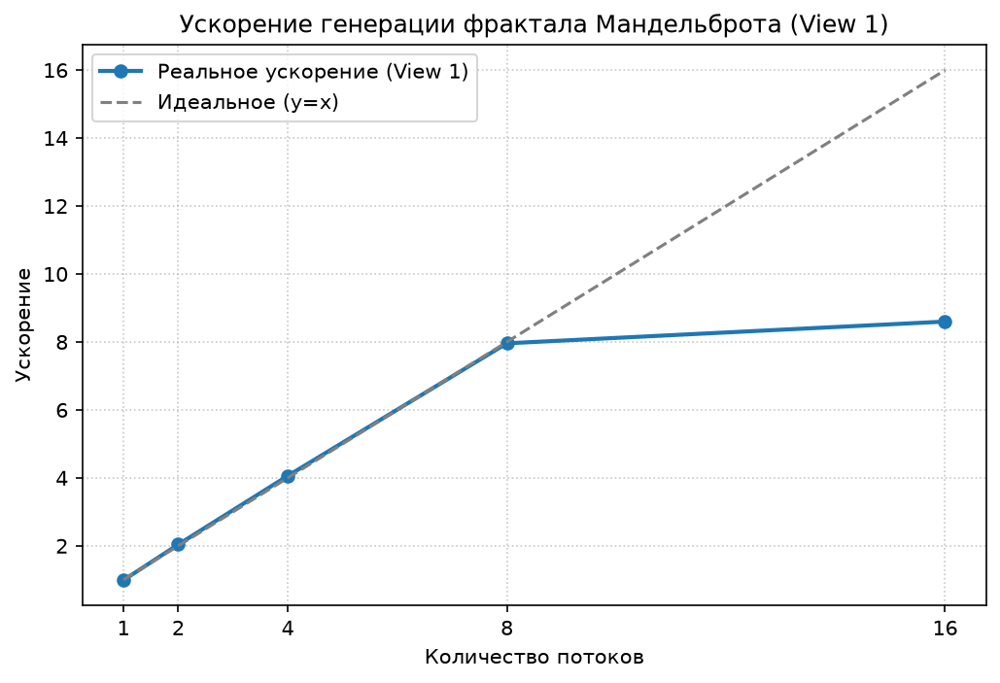

# Лабораторная работа №5
## Stanford CS149 — Assignment 1: Program 1 (Parallel Fractal Generation Using Threads)

**Выполнил студент:** Екимов Никита Алексеевич   
**Группа:** 6214-100503D  
**Курс:** Параллельное программирование

---

## 1. Задание

Взять программу `prog1_mandelbrot_threads` из репозитория Stanford CS149 и выполнить её по пунктам, указанным в оригинальном README (Program 1).

---

## 2. Реализация

- Распараллеливание выполнено с помощью `std::thread`.
- **Стратегия:** Чередующееся распределение строк (interleaved/cyclic distribution).
- **Как работает:** поток `threadId` вычисляет строки `threadId, threadId + numThreads, threadId + 2*numThreads, ...`. Для каждой строки вызывается `mandelbrotSerial()` с параметрами `startRow = j` и `numRows = 1`.
- Замер времени каждого потока выполняется через `CycleTimer::currentSeconds()` в начале и конце `workerThreadStart()`.

### Параллельный участок кода

```cpp
void workerThreadStart(WorkerArgs * const args) {
    double startTime = CycleTimer::currentSeconds();

    // Чередующееся распределение строк (interleaved)
    for (int j = args->threadId; j < args->height; j += args->numThreads) {
        mandelbrotSerial(
            args->x0, args->y0, args->x1, args->y1,
            args->width, args->height,
            j, 1,  // startRow = j, numRows = 1
            args->maxIterations,
            args->output
        );
    }

    double endTime = CycleTimer::currentSeconds();
    printf("Thread %d: %.3f ms\n", args->threadId, (endTime - startTime) * 1000);
}
```

---

## 3. Структура проекта

```
parallel_programming/
├── lab5/
│   ├── common/                      
│   │   ├── CycleTimer.h            
│   │   ├── ppm.cpp                  
│   │   └── tasksys.cpp              
│   ├── prog1_mandelbrot_threads/     
│   │   ├── main.cpp                  
│   │   ├── mandelbrotSerial.cpp      
│   │   ├── mandelbrotThread.cpp     
│   │   └── Makefile                  
│   ├── experiments_cs149.txt         
│   ├── speedup_view1.png             
│   └── README.md                     
└── scripts/
    ├── generate_matrix.py            
    ├── experiments_cs149.py          
    └── ...                                 
```

---

## 4. Результаты (View 1)

Замеры проводились автоматическим скриптом (`scripts/experiments_cs149.py`). Для каждого количества потоков программа внутри делает 5 замеров и берет минимальное время.

| Потоки | Ускорение |
|:-------|:----------|
| 1      | 0.99x     |
| 2      | 2.04x     |
| 4      | 4.06x     |
| 8      | 7.96x     |
| 16     | 8.60x     |

### График ускорения от числа потоков (View 1)



---

## 5. Результаты (View 2)

| Потоки | Ускорение |
|:-------|:----------|
| 8      | 7.38x     |

Ускорение на View 2 также находится в требуемом диапазоне 7–8x. Это подтверждает, что стратегия чередования строк работает хорошо для любой сложности картинки.

---

## 6. Анализ и ответы на пункты задания

**П.2. Линейно ли ускорение?**  
Ускорение растет почти линейно до 8 потоков (7.96x на 8 потоках). Это объясняется тем, что мы используем чередование строк, которое выравнивает нагрузку между потоками. При простом делении на блоки (верх/низ) ускорение было бы хуже из-за неравномерности вычислений (центральные пиксели фрактала требуют больше итераций).

**П.3. Время каждого потока.**  
Время выполнения потоков очень равномерное (разброс в пределах 1-2 мс). Это объясняет высокое ускорение: все потоки завершают работу почти одновременно, и общее время определяется самым медленным потоком.

**П.4. Улучшение распределения.**  
Мы использовали чередование строк. Это позволило достичь ускорения **7.96x на 8 потоках** (View 1) и **7.38x** (View 2), что соответствует требованию задачи (7–8x).

**П.5. 16 потоков.**  
При 16 потоках ускорение составило 8.60x, что лишь немного выше, чем на 8 потоках. Это связано с тем, что физических ядер меньше, чем потоков (Hyper-Threading). Потоки конкурируют за ресурсы процессора, и прирост производительности ограничен.

---

## 7. Сборка и запуск

### Сборка (в MSYS2 UCRT64)

```bash
cd /c/parallel_programming/lab5/prog1_mandelbrot_threads
make
```

### Автоматизированный запуск серии экспериментов
Из корня репозитория (в обычном `cmd`, не в MSYS2):
```cmd
py -3.12 scripts\experiments_cs149.py
```
Скрипт сам запустит `mandelbrot.exe` с разным числом потоков, соберет ускорение, сохранит таблицу в `experiments_cs149.txt` и перезапишет график `speedup_view1.png`.

### Ручной запуск
```bash
./mandelbrot -t 8
./mandelbrot -t 8 --view 2
```

---

## 8. Выводы

1.  Параллельная реализация фрактала Мандельброта с использованием `std::thread` и чередующегося распределения строк дает ускорение **7.96x** на 8 потоках для View 1 и **7.38x** для View 2.
2.  Время выполнения потоков сбалансировано, что подтверждает эффективность выбранной стратегии.
3.  16 потоков не дают значительного прироста по сравнению с 8 потоками из-за ограничений аппаратного обеспечения (Hyper-Threading).
4.  Программа успешно собрана и запущена в среде MSYS2 UCRT64 под Windows.
